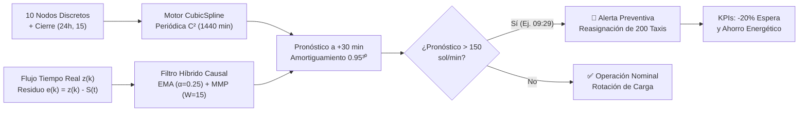

# 🚖 AutoFlow • MovePredict Engine
### Optimización Dinámica y Despacho Predictivo en Flota de Taxis Autónomos (AutoMove City • Bogotá)


**AutoFlow (`MovePredict`)** es una solución de **Análisis Numérico, Algoritmos y Simulación** diseñada para **AutoMove City**, operador de una flota de **200 taxis autónomos en Bogotá D.C.** El sistema reconstruye la curva continua de demanda minuto a minuto ($1440\text{ minutos}$) a partir de 10 reportes discretos no equidistantes mediante **Splines Cúbicos con Condición de Frontera Periódica ($C^2$)** e integra un **Filtro Predictivo Causal a 30 minutos (Suavizado Exponencial + Media Móvil Ponderada)** para emitir alertas preventivas de reasignación de flota.

---

## 📌 Tabla de Contenidos
1. [Contexto y Problema Numérico](#-1-contexto-y-problema-numérico)
2. [Modelo Matemático: Splines Cúbicos Periódicos](#-2-modelo-matemático-splines-cúbicos-periódicos)
3. [Validación Cruzada (Hold-Out) y Comparativa de Modelos](#-3-validación-cruzada-hold-out-y-comparativa-de-modelos)
4. [Resultados Operativos: Umbral Crítico e Integral Diaria](#-4-resultados-operativos-umbral-crítico-e-integral-diaria)
5. [Mejora Tecnológica: Filtro Predictivo Causal (+30 min)](#-5-mejora-tecnológica-filtro-predictivo-causal-30-min)
6. [Arquitectura del Sistema y KPIs](#-6-arquitectura-del-sistema-y-kpis)
7. [Plataforma Web Interactiva (Dashboard)](#-7-plataforma-web-interactiva-dashboard)
8. [Instalación y Ejecución Rápida](#-8-instalación-y-ejecución-rápida)

---

## 🏙️ 1. Contexto y Problema Numérico

El sistema central de despacho de **AutoMove City** recibe reportes consolidados de demanda de pasajeros en **10 instantes clave** del día (con mayor frecuencia de muestreo en horas de transición), pero requiere estimar la demanda **cada minuto del día** ($1440\text{ minutos}$, desde $t = 0.0\text{ h}$ hasta $t = 23.983\text{ h}$) para reasignar vehículos de forma proactiva y disminuir los tiempos de espera.

### Nodos de Muestreo y Cierre Periódico
Para evitar extrapolación polinómica entre las $21.0\text{ h}$ y las $24.0\text{ h}$ y garantizar continuidad cíclica entre días consecutivos, se incorpora el **nodo de cierre $(24.0, 15)$**:

| Nodo ($i$) | Hora del día ($t_i$, decimal) | Hora (`HH:MM`) | Demanda ($y_i$, solicitudes/min) | Tipo de Nodo |
| :---: | :---: | :---: | :---: | :--- |
| **1** | `0.0` | `00:00` | **15** | Inicio de ciclo |
| **2** | `1.5` | `01:30` | **18** | Transición madrugada |
| **3** | `3.0` | `03:00` | **12** | Valle nocturno |
| **4** | `6.0` | `06:00` | **45** | Inicio hora pico mañana |
| **5** | `9.0` | `09:00` | **120** | Ascenso mañana *(Retirado en Hold-Out)* |
| **6** | `12.0` | `12:00` | **180** | Pico mediodía |
| **7** | `15.0` | `15:00` | **150** | Frontera exacta umbral crítico |
| **8** | `18.0` | `18:00` | **98** | Retorno tarde *(Retirado en Hold-Out)* |
| **9** | `19.5` | `19:30` | **75** | Transición nocturna |
| **10** | `21.0` | `21:00` | **55** | Descenso nocturno |
| **11 (Cierre)** | `24.0` | `24:00` | **15** | **Nodo de cierre periódico (S(24) = S(0))** |

---

## 📐 2. Modelo Matemático: Splines Cúbicos Periódicos

En cada uno de los $10$ subintervalos $[t_i, t_{i+1}]$, la demanda se modela mediante un polinomio cúbico local:

$$S_i(t) = a_i + b_i(t - t_i) + c_i(t - t_i)^2 + d_i(t - t_i)^3, \quad t \in [t_i, t_{i+1}]$$

El sistema consta de **10 tramos y 40 coeficientes** determinados de forma única por:
* **20 ecuaciones** de interpolación exacta en los extremos de cada subintervalo.
* **18 ecuaciones** de continuidad interior de primera y segunda derivada ($S_{i-1}'(t_i) = S_i'(t_i)$ y $S_{i-1}''(t_i) = S_i''(t_i)$).
* **2 condiciones de frontera periódica** en el empalme de medianoche:
  $$S'(0) = S'(24) = -1.9495 \text{ sol/(min}\cdot\text{h)}, \qquad S''(0) = S''(24) = 13.9683 \text{ sol/(min}\cdot\text{h}^2)$$

### Tabla de Coeficientes Cúbicos Calculados (`bc_type='periodic'`)

| Tramo | Intervalo $[t_i, t_{i+1}]$ | $a_i$ | $b_i$ | $c_i$ | $d_i$ |
| :---: | :---: | :---: | :---: | :---: | :---: |
| **1** | $[0.0, 1.5]$ | `15.0000` | `-1.9495` | `6.9841` | `-2.9008` |
| **2** | $[1.5, 3.0]$ | `18.0000` | `-0.5773` | `-6.0694` | `2.5250` |
| **3** | $[3.0, 6.0]$ | `12.0000` | `-1.7414` | `5.2933` | `-0.3487` |
| **4** | $[6.0, 9.0]$ | `45.0000` | `20.6028` | `2.1547` | `-0.2297` |
| **5** | $[9.0, 12.0]$ | `120.0000` | `27.3302` | `0.0877` | `-0.8437` |
| **6** | $[12.0, 15.0]$ | `180.0000` | `5.0763` | `-7.5057` | `0.8268` |
| **7** | $[15.0, 18.0]$ | `150.0000` | `-17.6355` | `-0.0649` | `0.0552` |
| **8** | $[18.0, 19.5]$ | `98.0000` | `-16.5343` | `0.4319` | `0.2458` |
| **9** | $[19.5, 21.0]$ | `75.0000` | `-13.5792` | `1.5381` | `-0.9161` |
| **10** | $[21.0, 24.0]$ | `55.0000` | `-15.1487` | `-2.5844` | `1.0632` |

---

## 🔬 3. Validación Cruzada (Hold-Out) y Comparativa de Modelos

Para evaluar la capacidad de generalización fuera de muestra, se retiraron simultáneamente dos nodos intermedios de transición: **`(9.0 h, 120)`** y **`(18.0 h, 98)`**.

| Método de Interpolación | Predicción $t=9.0\text{ h}$ *(Real: 120)* | Predicción $t=18.0\text{ h}$ *(Real: 98)* | **RMSE** | **Error Máximo** | Diagnóstico Técnico |
| :--- | :---: | :---: | :---: | :---: | :--- |
| **Spline Cúbica Periódica** | `126.8275` | `97.5958` | **4.8362** | **6.8275** | **Óptima:** Reduce el RMSE **11.89%** frente a Lineal y garantiza cierre $C^2$. |
| **Spline Cúbica Natural** | `126.7058` | `98.2211` | `4.7443` | `6.7058` | Fuerza $S''(0)=S''(24)=0$, rompiendo la derivada en el cambio de día. |
| **Lineal a Trozos** | `112.5000` | `100.0000` | `5.4886` | `7.5000` | Presenta discontinuidades en $S'(t)$ (picos angulares en cada nodo). |
| **Polinomio Global Lagrange** | `131.9566` | `95.6351` | `8.6184` | `11.9566` | Degradación severa por **fenómeno de Runge** al usar grado global alto. |

> **Justificación de Frontera Periódica vs. Natural:** Aunque la Spline Natural presenta un RMSE marginalmente menor en los dos nodos centrales retirados (donde las fronteras $t=0$ y $t=24$ no influyen), en la frontera de medianoche genera un quiebre abrupto de pendiente ($S'(0) = +5.3941$ vs. $S'(24) = -13.8617$). La **Spline Periódica** asegura una transición suave y físicamente consistente entre días consecutivos.

---

## 🚨 4. Resultados Operativos: Umbral Crítico e Integral Diaria

Al reconstruir los **1440 minutos** del día ($t_k = k/60,\; k = 0, \dots, 1439$):

* **Raíces Continuas Exactas ($S(t) = 150$):**
  $$t_1 = 10.139155\text{ h} \approx 10\text{h } 08\text{m } 21\text{s}, \qquad t_2 = 15.000000\text{ h} = 15\text{h } 00\text{m } 00\text{s}$$
* **Minutos Discretos que Superan el Umbral Crítico ($S(t_k) > 150\text{ sol/min}$):**
  * **Inicio:** `10:09` (Minuto `609`)
  * **Fin:** `14:59` (Minuto `899`, dado que a las `15:00` el valor es exactamente `150.00`)
  * **Duración Total en Sobrecarga:** **291 minutos** ($4.85\text{ horas}$)
* **Pico Máximo de Demanda:** **`180.20 solicitudes/min`** a las **`12:12`** (Minuto `732`)
* **Valle Mínimo de Demanda:** **`11.86 solicitudes/min`** a las **`02:39`** (Minuto `159`)
* **Volumen Total Estimado de Solicitudes Diarias:**
  $$N_{\text{diario}} = 60 \int_{0}^{24} S(t)\,dt = \mathbf{121,823.79\text{ solicitudes/día}}$$

---

## ⚡ 5. Mejora Tecnológica: Filtro Predictivo Causal (+30 min)

Dado que los nodos base no son equidistantes, se implementó un **Filtro Predictivo de Corto Plazo** que opera minuto a minuto sobre el residuo observado en tiempo real $e_k = z_k - S(k/60)$:

1. **Suavizado Exponencial Simple (EMA):**
   $$L_k = \alpha e_k + (1 - \alpha) L_{k-1}, \qquad \alpha = 0.25$$
2. **Media Móvil Ponderada (MMP):**
   $$W_k = \frac{\sum_{j=1}^{n} j \cdot e_{k - n + j}}{\sum_{j=1}^{n} j}, \qquad n = \min(k+1, 15)$$
3. **Pronóstico Causal Amortiguado a $H = 30\text{ minutos}$:**
   $$\hat{z}_{k+30 \mid k} = \max\left(0,\; S\left(\frac{k+30}{60}\right) + 0.95^{30}\left(\frac{L_k + W_k}{2}\right)\right)$$

### Desempeño del Filtro (Semilla Reproducible `42` • 1410 Pares Evaluados)
* **Primera Alerta Preventiva Emitida:** **`09:29`** (proyectando **`150.10 sol/min`** para las **`09:59`**).
* **RMSE Curva Base:** `7.0051` $\longrightarrow$ **RMSE Filtro Causal Amortiguado:** **`6.8330`** *(Sin amortiguamiento $0.95^{30}$ el RMSE se degrada a `8.3168`)*.
* **Matriz de Confusión de Alertas ($>150\text{ sol/min}$):**
  * **Verdaderos Positivos ($TP$):** `276` | **Falsos Positivos ($FP$):** `25`
  * **Falsos Negativos ($FN$):** `31` | **Verdaderos Negativos ($TN$):** `1078`
  * **Precisión:** **`91.69%`** | **Sensibilidad (Recall):** **`89.90%`**

---

## 🏗️ 6. Arquitectura del Sistema y KPIs



---

## 🖥️ 7. Plataforma Web Interactiva (Dashboard)

El repositorio incluye una aplicación web interactiva de última generación (`index.html`, `styles.css`, `app.js`) con soporte **100% offline**:

* **Simulador Operativo Minuto a Minuto (00:00 – 23:59):** Reproducción automática a velocidades `1x`, `5x` y `15x`, botones de salto rápido a instantes clave y medidores radiales SVG animados.
* **Radar Táctico Animado de Bogotá (Canvas 60 FPS):** Simulación espacial de las 200 unidades autónomas desplazándose entre *Usaquén, Chapinero, Centro Internacional, Salitre, El Dorado y Suba*, con barras de distribución de flota en vivo.
* **Estudio Gráfico con 3 Vistas Interactivas:**
  1. *Curva 24h (Spline Periódica vs. Natural vs. Lineal vs. Lagrange)* con cursor vertical luminoso y banda sombreada de $+30\text{ min}$.
  2. *Filtro Predictivo & Alertas a 30 minutos*.
  3. *Validación Cruzada Hold-Out ($t=9\text{h}, 18\text{h}$)*.
* **Laboratorio de Calibración en Vivo:** Permite modificar en tiempo real el **Umbral Crítico**, el factor **$\alpha$ (EMA)**, la **Ventana $W$ (MMP)** y el switch de **Amortiguamiento ($0.95^{30}$)**, recalculando al instante el RMSE y la Matriz de Confusión.
* **Inspector Dinámico de los 10 Polinomios Cúbicos:** Resalta el tramo activo $[t_i, t_{i+1}]$ y evalúa en pantalla la fórmula cúbica con el $\Delta t$ del minuto actual.

---

## 🚀 8. Instalación y Ejecución Rápida

### Opción A: Abrir el Dashboard Directamente (Sin instalar nada)
Haz **doble clic** sobre el archivo `index.html` en cualquier navegador moderno (Chrome, Edge, Firefox, Safari). Todos los datos (`data.js`) y gráficos (`chart.min.js`) están incluidos localmente.

### Opción B: Levantar el Servidor Local con Python
```bash
git clone https://github.com/dsavilam/AutoFlow_AnalisisNumerico.git
cd AutoFlow_AnalisisNumerico
python serve.py
```
El servidor iniciará en `http://localhost:8000/index.html` y abrirá tu navegador automáticamente.

---

### 📂 Estructura del Repositorio

```text
AutoFlow_AnalisisNumerico/
├── index.html          # Dashboard interactivo de simulación y despacho (Frontend)
├── styles.css          # Sistema de diseño visual, animaciones y medidores radiales
├── app.js              # Motor JS de filtrado en vivo, gráficas y radar de Bogotá
├── data.js             # Dataset precalculado de los 1440 minutos (soporte file://)
├── data.json           # Resultados analíticos, coeficientes y métricas en formato JSON
├── chart.min.js        # Librería Chart.js v4 local para funcionamiento 100% offline
├── serve.py            # Servidor HTTP local con apertura automática en navegador
├── AutoFlow.ipynb      # Cuaderno Jupyter original con el desarrollo matemático y validación
└── README.md           # Documentación técnica y ejecutiva del proyecto
```
